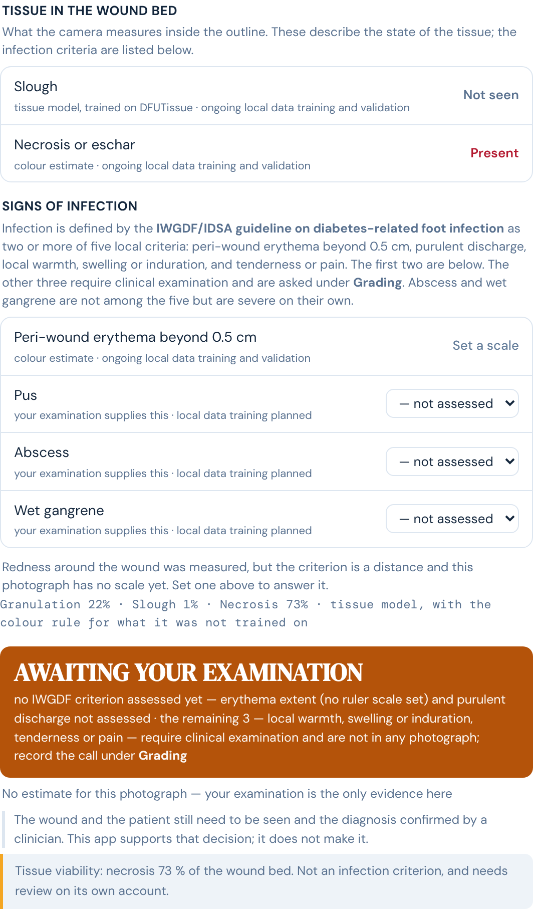
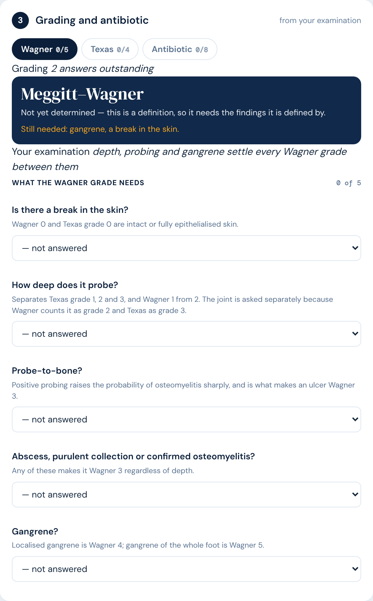
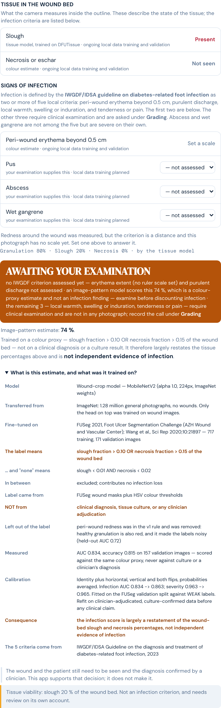

# Deployed check — 13 November 2026

**Verdict: `build 2026-11-13 · v11.3` is live at `/dfu/`, byte-identical to `7777b0c`, and runs clean — PASS, with one qualification: two of the three strings listed as "must be absent" are still present in the file, but only inside source comments, never in rendered output.**

Checked against commit `7777b0c` ("The estimate says what it estimates (v11.3)"), confirmed as the tip of `origin/main` in the local checkout before testing. Target: <https://htpn-clinical-checker.vercel.app/dfu/>.

---

## 1. Is v11.3 actually live?

| Item | Observed |
|---|---|
| `` | `build 2026-11-13 &middot; v11.3` |
| HTTP status of `/dfu/` | 200 |
| Deployed size | 496,812 bytes |
| Local `7777b0c:dfu/index.html` size | 496,812 bytes |
| Deployed SHA-256 | `e6514b3376a4dd66f6dc7e089cf26ae532a21bef28524a5f0ef5957db92e445b` |
| Local SHA-256 | `e6514b3376a4dd66f6dc7e089cf26ae532a21bef28524a5f0ef5957db92e445b` |
| Byte comparison | **Identical** — zero differing bytes |

Vercel has picked up the push. The served file is the committed file, not a near copy.

## 2. Are the v11.3 strings live?

### Must be present — all six found

| String | Result | Occurrences |
|---|---|---|
| `Image-pattern estimate` | Present | 1 |
| `no IWGDF criterion assessed yet` | Present | 1 |
| `require clinical examination and are not in any photograph` | Present | 1 |
| `not independent evidence of infection` | Present | 1 |
| `What is this estimate, and what was it trained on?` | Present | 1 |
| `gradeTabBar` | Present | 2 |

### Must be absent — one clean, two qualified

| String | Result | Where |
|---|---|---|
| `flagged by the model, not by the criteria` | **Absent** | — |
| `0 of 5 criteria seen here` | Present ×2 | Lines 3547, 3551 — both inside `/* … */` comment blocks |
| `likelihood of infection` | Present ×3 | Lines 1730, 3599, 3600 — all inside `/* … */` comment blocks |

Every surviving occurrence sits in a comment that explains why the wording was removed. For example, line 3551 opens `/* "0 of 5 criteria seen here" was the single most misleading string on the screen…`, and line 3599 reads `This read "Transfer-learned estimate: 76 % likelihood of infection". It is not a likelihood of infection.`

None of the five is in a template literal, an attribute or any other path that reaches the DOM. The browser run in section 5 confirms this: neither phrase appears in the rendered results panel for any sample tested. This is a grep artefact of self-documenting source, not a live regression. It is recorded here because the brief listed the strings as absolute, and a literal grep over the deployed file does return hits.

## 3. Are the model cards live with the new field?

| URL | Status | Valid JSON | Bytes |
|---|---|---|---|
| `/dfu/model/metrics.json` | 200 | Yes | 1,796 |
| `/dfu/model-roi/metrics.json` | 200 | Yes | 2,016 |
| `/dfu/model-roi/calibration.json` | 200 | Yes | 1,087 |
| `/dfu/seg/metrics.json` | 200 | Yes | 667 |
| `/dfu/tissue/metrics.json` | 200 | Yes | 3,377 |

Required fields:

| Card | `label_rule` object | `infection_suspected_if` | `dataset` | `criteria_guideline` |
|---|---|---|---|---|
| `/dfu/model/metrics.json` | Present | Present | Present | Present |
| `/dfu/model-roi/metrics.json` | Present | Present | Present | Present |

`label_rule` on both cards carries ten keys: `source`, `derived_from`, `NOT_derived_from`, `infection_suspected_if`, `infection_none_if`, `between_thresholds`, `slough_defined_as`, `necrosis_defined_as`, `erythema_dropped_in_v2`, `consequence`.

Value of `label_rule.infection_suspected_if` from the deployed **model-roi** card, quoted verbatim:

> `slough fraction > 0.10 OR necrosis fraction > 0.15 of the wound bed`

The `/dfu/model/metrics.json` card carries the identical string.

Supporting fields from the same card:

| Field | Value |
|---|---|
| `dataset` | FUSeg 2021, Foot Ulcer Segmentation Challenge (AZH Wound and Vascular Center); Wang et al., Sci Rep 2020;10:21897 |
| `criteria_guideline` | IWGDF/IDSA Guideline on the diagnosis and treatment of diabetes-related foot infection, 2023 |

## 4. Cache headers

Every URL checked returned `public, max-age=0, must-revalidate` with a strong `ETag`. Nothing is missing the revalidation directive.

| URL | Status | `Cache-Control` | `ETag` |
|---|---|---|---|
| `/dfu/` (directory index) | 200 | `public, max-age=0, must-revalidate` | `"043c4be1ccb8d3273a1aa3a8e8a8cb15"` |
| `/dfu` (no trailing slash) | 200 | `public, max-age=0, must-revalidate` | `"043c4be1ccb8d3273a1aa3a8e8a8cb15"` |
| `/dfu/index.html` | 200 | `public, max-age=0, must-revalidate` | `"043c4be1ccb8d3273a1aa3a8e8a8cb15"` |
| `/dfu/seg/model.json` | 200 | `public, max-age=0, must-revalidate` | `"78ae29293ad31ba1f1d6004f5d0e20cf"` |
| `/dfu/seg/group1-shard1of3.bin` | 200 | `public, max-age=0, must-revalidate` | `"48105f9aae3525e678beedaac8bffe54"` |
| `/dfu/tissue/group1-shard1of3.bin` | 200 | `public, max-age=0, must-revalidate` | `"100026d382fb3be9d80979e2b728c297"` |
| `/dfu/model-roi/group1-shard1of2.bin` | 200 | `public, max-age=0, must-revalidate` | `"f0f6ce63cf8f59e1dc78b2d9b7c9b333"` |
| `/dfu/model-roi/metrics.json` | 200 | `public, max-age=0, must-revalidate` | `"2f2d3cc5ef17c34a5f616fb8efc13c96"` |

On the specific concern about the directory index: `/dfu/` **is** covered. All three of `/dfu`, `/dfu/` and `/dfu/index.html` return the same `ETag` and the same `Cache-Control`. Vercel resolves the directory index to `/dfu/index.html` before applying the header rules, so the `/(.*).html` rule catches it; the bare `/dfu` rule is belt-and-braces. The stale-shard-beside-fresh-manifest failure mode the rules exist to prevent is therefore closed on every path tested.

## 5. Does it run?

Driven live with Playwright on Chromium, `page.on('pageerror')` and console-error capture enabled from first navigation, on `https://htpn-clinical-checker.vercel.app/dfu/?arm=dfu`. Entry gate ticked (`#ack1`, `#ack2`), `#enter` clicked, then waited on `segModel`.

**Sample used:** the 4th `button.sample[data-dis="dfu"]` — `Sample D`, `samples/necrotic_forefoot_ulcer.jpg`. Seven DFU sample buttons were present. Inference took 19.1 s over 4 test-time-augmentation views.

| Element | Text as rendered |
|---|---|
| Verdict headline | `AWAITING YOUR EXAMINATION` (banner class `verdict unk`) |
| Basis line | `no IWGDF criterion assessed yet — erythema extent (no ruler scale set) and purulent discharge not assessed · the remaining 3 — local warmth, swelling or induration, tenderness or pain — require clinical examination and are not in any photograph; record the call under Grading` |
| `.est` block | `No estimate for this photograph — your examination is the only evidence here` |

The basis line carries two of the six required v11.3 strings in live rendered output: `no IWGDF criterion assessed yet` and `require clinical examination and are not in any photograph`.

### Why Sample D shows no estimate

This is correct abstention, not a failure. The infection head returned `[0.558, 0.442]`; the larger probability, 0.558, is below `ABSTAIN_AT = 0.70`, so `infEstimates()` returned an empty array and the panel printed the abstain wording. All model files loaded — twenty requests across `seg`, `tissue`, `model` and `model-roi` (manifests, shards and metrics), **every one HTTP 200, no failures**. `CARDS` held `Whole-photo model` and `Wound-crop model`; `CALIB` held `severity` and `infection`.

To confirm the `Image-pattern estimate` wording renders live rather than merely existing in the file, all seven DFU samples were run, each waited on until `lastPred` refreshed:

| Sample | Confidence (max of the two class probabilities) | `.est` rendered |
|---|---|---|
| A — small leg ulcer | 0.516 | Abstained |
| B — sloughy heel ulcer | 0.838 | `Image-pattern estimate: 84 %` |
| C — large ankle ulcer | 0.762 | `Image-pattern estimate: 76 %` |
| **D — necrotic forefoot ulcer** | **0.558** | **Abstained** |
| E — plantar eschar ulcer | 0.921 | `Image-pattern estimate: 8 %` |
| F — landscape off-centre | 0.793 | `Image-pattern estimate: 79 %` |
| G — portrait phone | 0.738 | `Image-pattern estimate: 74 %` |

**On that column, corrected after review.** It was originally headed "max infection
probability", which it is not. `abstains = p => Math.max(p[0], p[1]) < ABSTAIN_AT` tests the
larger of the two class probabilities — the head's *confidence* — not the infection
probability. For most rows the two coincide because "infection suspected" is the larger class,
which is why 0.838 renders as 84 %. Sample E is the row that exposes the difference: its 0.921
is confidence in "no infection", so the infection probability is 0.079 and the panel correctly
prints 8 %. The figures in the table are right; only the heading was wrong.

Five of seven render the new wording in full, each followed by `Trained on a colour proxy — slough fraction > 0.10 OR necrosis fraction > 0.15 of the wound bed — not on a clinical diagnosis or a culture result… and is not independent evidence of infection`, with the `
` provenance table attached. The two abstentions are the two samples below the 0.70 threshold. The behaviour is consistent with the stated design.

### Grading tab

`#gradeTabBar` renders three sub-tabs, labels and counts exactly as expected:

| Sub-tab | Label as rendered | Questions on the tab |
|---|---|---|
| 1 | `Wagner 0/5` | 5 |
| 2 | `Texas 0/4` | 4 |
| 3 | `Antibiotic 0/8` | 8 |

Question counts were taken after clicking each tab, and match the labels in every case.

- **Wagner (5):** break in the skin; depth on probing; probe-to-bone; abscess, purulent collection or confirmed osteomyelitis; gangrene.
- **Texas (4):** break in the skin; depth on probing; clinically infected; ischaemic limb.
- **Antibiotic (8):** depth on probing; probe-to-bone; abscess, purulent collection or confirmed osteomyelitis; gangrene; clinically infected; ischaemic limb; extent of surrounding erythema or cellulitis; systemic signs of sepsis.

### Errors

| Channel | Count |
|---|---|
| Page errors (`pageerror`) | **0** |
| Console errors | **0** |
| Failed requests | **0** |
| HTTP ≥ 400 responses | **0** |

Zero across every run, including the seven-sample sweep.

### Screenshots

Taken at `deviceScaleFactor: 2`.

Results panel for Sample D, provenance expanded (no provenance block exists for an abstaining sample, so the panel shows the abstain wording):

Grading card on the Wagner sub-tab, showing the `gradeTabBar`:

Results panel for a non-abstaining sample (Sample G, portrait phone) with `
` forced open — included because Sample D abstains and therefore renders no provenance table, and the provenance table is the substance of the v11.3 change:

## What to fix

Nothing blocks the release. One item is worth a decision, and one is a note.

1. **Dead strings in comments (cosmetic, optional).** `0 of 5 criteria seen here` and `likelihood of infection` survive in five comment blocks. They are quoted deliberately, as the record of what was wrong and why it changed, and that record has value. But any future grep-based release check over the deployed file will keep flagging them. Either reword the comments so the retired phrasing is not reproduced verbatim, or move the rationale into a changelog and have the release check scan rendered DOM text rather than source. The second is the sounder fix: a source grep cannot distinguish a comment from a template literal, so it will go on producing false positives whatever the wording.

2. **No action needed on the abstentions.** Samples A and D showing no estimate is the `ABSTAIN_AT = 0.70` threshold doing its job, and the replacement wording reads as a statement about the evidence rather than about the model, which was the point of the change. Flagged only so it is not mistaken for a model-loading fault in a later read of this report.
