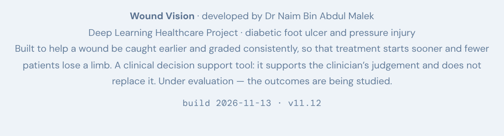

# Live release check — v11.12, 13 November 2026

**PASS — 40 of 40 checks passed, node exit code 0.**
Live build stamp served: `build 2026-11-13 · v11.12`.

Both of the things v11.12 changed were verified on the real deployment rather than inferred
from a green run. The footer build stamp is genuinely **visible** to a tester — `display:
block`, `visibility: visible`, a non-null `offsetParent`, a 568 × 17.84 px box and an empty
`className` — and the default `--expect` path prints **`expect : v11.12`**, not
`(not specified)`. The `'backend'` page error did **not** appear.

## Run

| | |
|---|---|
| Command | `node docs/release-check.mjs https://htpn-clinical-checker.vercel.app --expect v11.12 > /tmp/live5.log 2>&1; echo "exit=$?"` |
| Repository tip | `c73e94b` — *The build stamp is visible to testers, and the check now proves it (v11.12)* |
| Target | `https://htpn-clinical-checker.vercel.app/dfu/` |
| **node exit code** | **0** |
| Wall-clock | **69 s** (`real 1m8.904s`) |
| Checks | 40 of 40 passed |
| Backend | `webgl` |

The exit code was taken from `$?` on the `node` command itself, not through a pipe. The build
served was v11.12 on the first attempt, so none of the five deployment retries were needed.

## Checks that did not pass

None. All 40 checks passed, so there is no detail string to report.

## Complete stdout

```

Wound Vision release check
  target : https://htpn-clinical-checker.vercel.app/dfu/
  expect : v11.12

  build stamp served: build 2026-11-13 · v11.12
  tf backend: webgl
  samples found: 7
    sample 1: abstained (confidence below the threshold)
    sample 2: Image-pattern estimate: 84 %
    sample 3: Image-pattern estimate: 76 %
    sample 4: abstained (confidence below the threshold)
    sample 5: Image-pattern estimate: 8 %
    sample 6: Image-pattern estimate: 79 %
    sample 7: Image-pattern estimate: 74 %
  grading sub-tabs: Wagner0/5 | Texas0/4 | Antibiotic0/8

  states visited: 18

  source scan (comments stripped) — advisory, never fails the run:
    ok    "likelihood of infection" appears only in comments
    ok    "0 of 5 criteria seen here" appears only in comments
    ok    "The model declined to classify this image" appears only in comments
    nothing reachable found outside comments

  ────────────────────────────────────────────────────────────────────────
  PASS  build stamp is v11.12
  PASS  build stamp is visible to a tester
  PASS  segmentation model loads
  PASS  at least one sample present
  PASS  sample 1 finishes inference
  PASS  sample 2 finishes inference
  PASS  sample 3 finishes inference
  PASS  sample 4 finishes inference
  PASS  sample 5 finishes inference
  PASS  sample 6 finishes inference
  PASS  sample 7 finishes inference
  PASS  examiner-confirmed severe sign still escalates
  PASS  three grading sub-tabs render
  PASS  wagner tab asks 5 questions
  PASS  texas tab asks 4 questions
  PASS  abx tab asks 8 questions
  PASS  visible: "Image-pattern estimate"
  PASS  visible: "no IWGDF criterion assessed yet"
  PASS  visible: "require clinical examination and are not in any photograph"
  PASS  visible: "not independent evidence of infection"
  PASS  visible: "What is this estimate, and what was it trained on?"
  PASS  visible: "slough fraction > 0.10 OR necrosis fraction > 0.15"
  PASS  visible: "LIKELY INFECTION"
  PASS  visible: "AWAITING YOUR EXAMINATION"
  PASS  visible: "This screen can reach two of"
  PASS  visible: "Peri-wound erythema beyond 0.5 cm"
  PASS  visible: "no detector is trained yet"
  PASS  visible: "clinical examination"
  PASS  visible: "either is severe"
  PASS  visible: "1,000 everyday object classes"
  PASS  visible: "not whether the wound is infected"
  PASS  never visible: "likelihood of infection"
  PASS  never visible: "0 of 5 criteria seen here"
  PASS  never visible: "flagged by the model"
  PASS  never visible: "no signs of infection"
  PASS  never visible: "The model declined to classify this image"
  PASS  no page errors
  PASS  no console errors
  PASS  no failed requests
  PASS  no HTTP >= 400
  ────────────────────────────────────────────────────────────────────────
  40 of 40 checks passed

```

## Backend and per-sample results

```
  tf backend: webgl
```

All seven per-sample lines:

```
    sample 1: abstained (confidence below the threshold)
    sample 2: Image-pattern estimate: 84 %
    sample 3: Image-pattern estimate: 76 %
    sample 4: abstained (confidence below the threshold)
    sample 5: Image-pattern estimate: 8 %
    sample 6: Image-pattern estimate: 79 %
    sample 7: Image-pattern estimate: 74 %
```

Samples 1 and 4 abstained. That is the abstention threshold doing its job, not a fault: both
`sample 1 finishes inference` and `sample 4 finishes inference` passed, which is what the check
asserts. The pattern matches the 13 November v11.3 re-run.

## The build stamp is visible on the real deployment

This is the point of the release, so it was checked directly on the live page rather than taken
from the passing check. Live `https://htpn-clinical-checker.vercel.app/dfu/?arm=dfu`, plain
tester view, entry gate passed by ticking both acknowledgements and clicking *Continue to the
tool*. **Study mode was not entered**: `document.body.className` was `arm-dfu` and the
`#passGate` overlay was never touched.

| Property | Observed | Expected | Result |
|---|---|---|---|
| `getComputedStyle(el).display` | `block` | not `none` | PASS |
| `getComputedStyle(el).visibility` | `visible` | `visible` | PASS |
| `el.offsetParent === null` | `false` | `false` — element is laid out | PASS |
| `getBoundingClientRect().width` | `568` px | > 0 | PASS |
| `getBoundingClientRect().height` | `17.84375` px | > 0 | PASS |
| `document.body.innerText` contains `v11.12` | `true` | `true` | PASS |
| `el.className` | `""` (length 0) | empty — no `study-hide`, no `study-only` | PASS |

Supporting values: `opacity` `1`, `font-size` `10.5px`, `color` `rgb(101, 126, 155)`,
`textContent` `build 2026-11-13 · v11.12`. The entry gate `#gate` computed to `display: none`
once passed. The measurement was run twice against the live deployment and returned identical
values both times.

The served markup carries the v11.12 change: the footer span is `<span id="buildStamp"></span>`
with **no class attribute at all**, and `const BUILD = '2026-11-13 · v11.12'` is rendered into
it at start-up. `study-hide` still appears four times elsewhere in the document, but not on this
span.

### Screenshot

Footer region as a tester sees it, captured at `deviceScaleFactor: 2`
(1200 × 326 device pixels, 600 × 163 CSS px):



The line `build 2026-11-13 · v11.12` is legible in faint monospace below the footer text.
Full-viewport context: [full-page-footer-view.png](live-v11-12/full-page-footer-view.png)

## The default `--expect` path works live

Run with no `--expect` flag at all:

```
node docs/release-check.mjs https://htpn-clinical-checker.vercel.app > /tmp/live6.log 2>&1; echo "exit=$?"
```

node exit code **0**, wall-clock **69 s** (`real 1m8.693s`), **40 of 40 checks passed**.

The `expect :` line it printed:

```
  expect : v11.12
```

**Not `(not specified)`.** The fix holds on the live path: `stampOf()` matches
`/const BUILD = '([^']+)'/` against the working tree's `dfu/index.html`, which at `c73e94b`
contains `const BUILD = '2026-11-13 · v11.12';` at line 4155, and the footer-markup regex
is retained only as a fallback for builds before v11.10. The guard added alongside it —
`refusing to run: no --expect given and no version could be read from dfu/index.html`, exit 2 —
was therefore not triggered.

Because `expect : v11.12` was derived rather than typed, `PASS  build stamp is v11.12` in the
no-flag run is a real assertion, not a skipped one. That is the regression this release was
meant to close, and it is closed.

## The `'backend'` page error

**It did not appear.** `PASS  no page errors` and `PASS  no console errors` in both the
`--expect` run and the no-flag run, and no errors of any kind in the two separate
instrumented loads used for the visibility check above — four clean observations in total.
There is no stack to quote, so the one thing still missing from the record remains missing.

Standing count: the error failed the first live run of v11.3 and has now been absent across
53 inferences in six sessions (39 before this one, plus 7 + 7 here).
