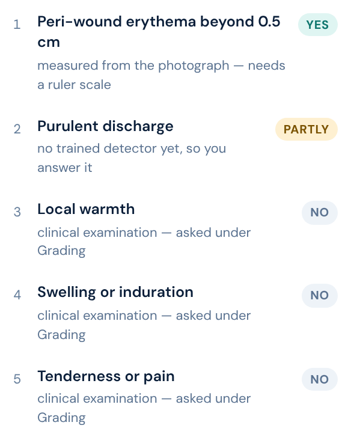
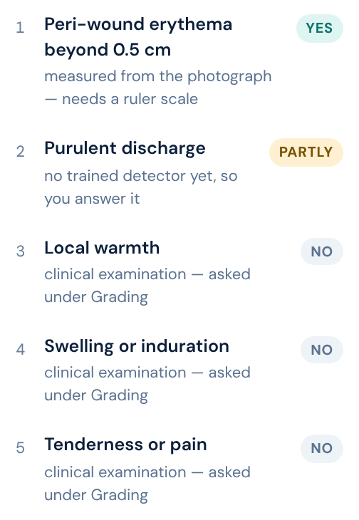

# Release check — live deployment, v11.4

**PASS — 38 of 38 checks passed, node exit code 0.**
**Live build stamp served: `build 2026-11-13 · v11.4`.**

## The run

| | |
|---|---|
| Command | `node docs/release-check.mjs https://htpn-clinical-checker.vercel.app --expect v11.4 > /tmp/live3.log 2>&1` |
| Node exit code | **0** (read from `$?` on the node command itself, not through a pipe) |
| Wall-clock time | **59 s** (started 2026-11-13 06:52:39 UTC, ended 06:53:38 UTC) |
| Target resolved to | `https://htpn-clinical-checker.vercel.app/dfu/` |
| Repository tip under test | `d311ca6` on `main` |
| Checks | 38 expected, 38 run, 38 passed |

v11.4 was already deployed when the run began; no retry for a stale build stamp was needed.

### Backend and per-sample results

```
  tf backend: webgl
```

All seven samples completed inference. Two abstained — that is the head declining below its
confidence threshold, not a failure, and the corresponding `sample N finishes inference`
checks passed for all seven.

```
    sample 1: abstained (confidence below the threshold)
    sample 2: Image-pattern estimate: 84 %
    sample 3: Image-pattern estimate: 76 %
    sample 4: abstained (confidence below the threshold)
    sample 5: Image-pattern estimate: 8 %
    sample 6: Image-pattern estimate: 79 %
    sample 7: Image-pattern estimate: 74 %
```

### Checks that did not pass

None. Every one of the 38 checks passed, so there is no detail string to report.

### The six v11.4 assertions

All six guards on the five-criteria explainability table and the lengthened ImageNet
provenance line rendered live:

| Phrase | Result |
|---|---|
| `This screen can reach two of` | PASS |
| `Peri-wound erythema beyond 0.5 cm` | PASS |
| `no trained detector yet, so you answer it` | PASS |
| `clinical examination` | PASS |
| `either is severe` | PASS |
| `1,000 everyday object classes` | PASS |

## Complete stdout, verbatim

```
Wound Vision release check
  target : https://htpn-clinical-checker.vercel.app/dfu/
  expect : v11.4

  build stamp served: build 2026-11-13 · v11.4
  tf backend: webgl
  samples found: 7
    sample 1: abstained (confidence below the threshold)
    sample 2: Image-pattern estimate: 84 %
    sample 3: Image-pattern estimate: 76 %
    sample 4: abstained (confidence below the threshold)
    sample 5: Image-pattern estimate: 8 %
    sample 6: Image-pattern estimate: 79 %
    sample 7: Image-pattern estimate: 74 %
  grading sub-tabs: Wagner0/5 | Texas0/4 | Antibiotic0/8

  states visited: 18

  source scan (comments stripped) — advisory, never fails the run:
    ok    "likelihood of infection" appears only in comments
    ok    "0 of 5 criteria seen here" appears only in comments
    ok    "The model declined to classify this image" appears only in comments
    nothing reachable found outside comments

  ────────────────────────────────────────────────────────────────────────
  PASS  build stamp is v11.4
  PASS  segmentation model loads
  PASS  at least one sample present
  PASS  sample 1 finishes inference
  PASS  sample 2 finishes inference
  PASS  sample 3 finishes inference
  PASS  sample 4 finishes inference
  PASS  sample 5 finishes inference
  PASS  sample 6 finishes inference
  PASS  sample 7 finishes inference
  PASS  examiner-confirmed severe sign still escalates
  PASS  three grading sub-tabs render
  PASS  wagner tab asks 5 questions
  PASS  texas tab asks 4 questions
  PASS  abx tab asks 8 questions
  PASS  visible: "Image-pattern estimate"
  PASS  visible: "no IWGDF criterion assessed yet"
  PASS  visible: "require clinical examination and are not in any photograph"
  PASS  visible: "not independent evidence of infection"
  PASS  visible: "What is this estimate, and what was it trained on?"
  PASS  visible: "slough fraction > 0.10 OR necrosis fraction > 0.15"
  PASS  visible: "LIKELY INFECTION"
  PASS  visible: "AWAITING YOUR EXAMINATION"
  PASS  visible: "This screen can reach two of"
  PASS  visible: "Peri-wound erythema beyond 0.5 cm"
  PASS  visible: "no trained detector yet, so you answer it"
  PASS  visible: "clinical examination"
  PASS  visible: "either is severe"
  PASS  visible: "1,000 everyday object classes"
  PASS  never visible: "likelihood of infection"
  PASS  never visible: "0 of 5 criteria seen here"
  PASS  never visible: "flagged by the model"
  PASS  never visible: "no signs of infection"
  PASS  never visible: "The model declined to classify this image"
  PASS  no page errors
  PASS  no console errors
  PASS  no failed requests
  PASS  no HTTP >= 400
  ────────────────────────────────────────────────────────────────────────
  38 of 38 checks passed
```

## The `backend` page error

**It did not appear.** `no page errors` passed, and the phone-width run below — a further two
full loads and two more inferences at 360 px and 320 px — recorded an empty `pageerror` list at
both widths.

So the record now stands at: failed once on the first live run, absent on the second across
twenty inferences, and absent again here across nine (seven release-check samples plus two
phone-width samples). Page errors now carry six stack frames, so had it recurred the stack
would be quoted here verbatim. There is no stack to quote, and that remains the gap in the
record — the fault has not been seen since, and it has still never been located.

## Does the table survive a phone?

Run separately from the release check, with a short Playwright script kept in the session
scratchpad rather than the repository (it is a one-off diagnostic, not a release gate). At each
width it loaded the live page, passed the entry gate, waited for the segmentation model, ran
one sample, and measured the rendered table.

| | 360 px | 320 px |
|---|---|---|
| Horizontal overflow (`scrollWidth > clientWidth`) | **No** — 360 = 360 | **No** — 320 = 320 |
| Elements extending past the viewport | none | none |
| `.critrow .can` chips wrapped onto their own line | **No** — all 5 | **No** — all 5 |
| `.critrow .can` chips clipped | **No** — all 5 | **No** — all 5 |
| Build stamp served to the phone viewport | `build 2026-11-13 · v11.4` | `build 2026-11-13 · v11.4` |
| Page errors | none | none |

**No horizontal overflow at either width.** There is no finding to report here.

Chip measurements, identical for all five rows at both widths: rendered height 19.5 px against
a computed single-line height of 19.5 px — an exact match, so no chip has taken a second line.
Each chip's `scrollWidth` equals its `clientWidth`, so none is clipped by its own box; and each
chip's right edge sits inside the table's right edge (315 px against 326 px at 360; 275 px
against 286 px at 320), so none is cut by the `overflow:hidden` on `.critt`. Each chip's top
edge is above its row label's bottom edge, meaning it is sitting beside the label rather than
having been pushed below it.

This is what the CSS intends: `.critrow .can` carries `flex-shrink:0` and `white-space:nowrap`,
and `.critrow .c` carries `min-width:0`, so the criterion text yields and the status chip keeps
its single line. At 320 px the longest label — "Peri-wound erythema beyond 0.5 cm" — wraps to two
lines, which is the intended behaviour and leaves the chip aligned to the first line.

### Screenshots

`#pubResult .critt` at 360 px:



`#pubResult .critt` at 320 px:



## Scope and limits

Three things this run does not establish, stated so the record is not read as more than it is:

1. The DOM assertions prove absence only in the 18 states the script visited. A forbidden phrase
   reachable only through some combination the script never produces would pass unnoticed. The
   advisory source scan narrows this but does not close it.
2. The phone-width check exercises one sample at each width, not all seven. It tests the table's
   layout, which does not vary by sample, but it is not a full pass at phone width.
3. Chromium at an emulated viewport is not a handset. It settles the layout question; it says
   nothing about touch targets, real-device scaling, or iOS Safari's own quirks.
